# ERD проектной схемы BA-PLAT-4.2 §2.22

**Статус:** DRAFT. Не реализованная миграция; проектная схема.
Дата: 2026-11-19.

Полные типы/ограничения — [`ba_schema.sql`](ba_schema.sql). Ниже — ключевые
связи; `*` означает обязательную связь, `?` — nullable.

```mermaid
erDiagram
    ACCOUNTS_USER ||--o| ACCOUNTS_PROFILE : has
    ACCOUNTS_USER ||--o{ ACCOUNTS_EMAIL : has
    ACCOUNTS_USER ||--o{ ACCOUNTS_RECOVERY_CODE : has
    ACCOUNTS_USER ||--o{ ACCOUNTS_NICKNAME_HISTORY : has
    ACCOUNTS_USER ||--o{ RATINGS_VOTE : votes
    ACCOUNTS_USER ||--o{ USER_GAME_PLAYTIME : plays
    ACCOUNTS_USER ||--o{ GAMEPLAY_SESSION : user_session
    ACCOUNTS_ANONYMOUS_IDENTITY ||--o{ GAMEPLAY_SESSION : anon_session
    ACCOUNTS_ANONYMOUS_IDENTITY ||--o{ CONTENT_COOKIE_CONSENT : anon_consent

    I18N_LANGUAGE ||--o{ CATALOG_GAME_TRANSLATION : translates
    I18N_LANGUAGE ||--o{ CATALOG_GENRE_TRANSLATION : translates
    I18N_LANGUAGE ||--o{ CATALOG_TAG_TRANSLATION : translates
    I18N_LANGUAGE ||--o{ I18N_TRANSLATION_ENTRY : entries
    I18N_LANGUAGE ||--o{ I18N_GAME_LOCALE_OVERRIDE : overrides

    CATALOG_GENRE ||--o{ CATALOG_GENRE_TRANSLATION : has
    CATALOG_GENRE ||--o{ CATALOG_GAME : primary_genre
    CATALOG_TAG ||--o{ CATALOG_TAG_TRANSLATION : has
    CATALOG_GAME }o--o{ CATALOG_TAG : game_tags
    CATALOG_GAME }o--o{ CATALOG_GENRE : additional_genres
    CATALOG_GAME ||--o{ CATALOG_GAME_VERSION : versions
    CATALOG_GAME ||--o{ CATALOG_GAME_TRANSLATION : translations
    CATALOG_GAME ||--o{ CATALOG_GAME_ASSET : assets
    CATALOG_GAME_VERSION ||--o{ CATALOG_GAME_ASSET : version_assets
    CATALOG_GAME ||--o{ CATALOG_GAME_IMPORT_DRAFT : drafts
    CATALOG_GAME ||--o{ RATINGS_VOTE : ratings
    CATALOG_GAME ||--|| RATINGS_AGGREGATE : aggregate
    CATALOG_GAME ||--o{ USER_GAME_PLAYTIME : playtime
    CATALOG_GAME ||--o{ GAMEPLAY_SESSION : game_sessions
    CATALOG_GAME_VERSION ||--o{ GAMEPLAY_SESSION : version_sessions
    CATALOG_GAME ||--o{ GAMEPLAY_RESULT : results
    CATALOG_GAME ||--o{ LEADERBOARDS_ENTRY : leaderboard
    GAMEPLAY_SESSION ||--o| GAMEPLAY_RESULT : result
    GAMEPLAY_RESULT ||--o| LEADERBOARDS_ENTRY : best_result
    CATALOG_GAME ||--o{ GAMEPLAY_DAILY_STATS : daily
    CATALOG_GAME ||--o{ GAMEPLAY_PLAY_CREDIT : credits
    CATALOG_GAME ||--o{ GAMEPLAY_STORAGE : storage
    GAMEPLAY_STORAGE }o--|| ACCOUNTS_USER : user_subject
    GAMEPLAY_STORAGE }o--|| ACCOUNTS_ANONYMOUS_IDENTITY : anon_subject

    CONTENT_PAGE ||--o{ CONTENT_PAGE_TRANSLATION : translations
    CONTENT_LEGAL_DOCUMENT ||--o{ CONTENT_LEGAL_DOCUMENT_VERSION : versions
    CONTENT_LEGAL_DOCUMENT_VERSION ||--o{ CONTENT_USER_LEGAL_ACCEPTANCE : accepted
    ACCOUNTS_USER ||--o{ CONTENT_USER_LEGAL_ACCEPTANCE : accepts
    CONTENT_SEO_SETTINGS }o--|| CATALOG_GAME : seo
    CONTENT_SEO_SETTINGS }o--|| CONTENT_PAGE : seo
    CONTENT_AD_SLOT ||--o{ ANALYTICS_EVENT : slot_events

    ACCOUNTS_USER ||--o{ SECURITY_EVENT : actor
    ACCOUNTS_USER ||--o{ ADMIN_AUDIT_LOG : actor
    ACCOUNTS_USER ||--o{ MODERATION_ACTION : operator
    ACCOUNTS_USER ||--o{ MODERATION_REPORT : reporter
    THEME_TOKEN_SET }o--|| ACCOUNTS_USER : updated_by
    THEME_SITE_SETTINGS ||--o{ CATALOG_GAME : reserved_labels
```

## Пояснения

- `GAMEPLAY_SESSION` имеет ровно один субъект: user или anon (CHECK).
- `GAMEPLAY_RESULT` ссылается на сессию и на игру; `game_id` добавлен для
  индексов §2.11.3.
- `GAMEPLAY_STORAGE` использует полиморфный subject (`user`/`anon`), поэтому
  на ERD показаны обе возможные связи; FK на полиморфную пару не создаётся,
  целостность обеспечивается CHECK/сервисом.
- `CONTENT_SEO_SETTINGS` использует generic object_type/object_id; на ERD
  показаны возможные цели.
- `THEME_SITE_SETTINGS` — singleton-настройки; связь с играми показана
  логически (reserved host labels), не FK.
